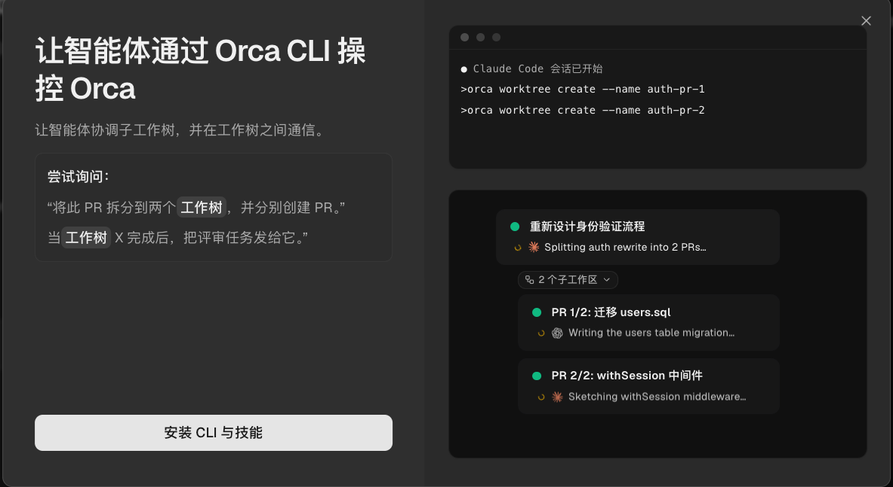

# 编排

**让智能体通过 Orca CLI 操控 Orca**

让智能体协调子工作树，并在工作树之间通信。

为你的智能体安装 Orca CLI 和编排技能。



这是 Orca 的**“通过 CLI 进行多智能体编排”**功能：你把一个大任务交给主智能体，它调用 Orca，为子任务创建工作树、启动其他智能体，再收集结果。截图中的例子，就是把一次“身份验证流程重构”拆成两部分，分别开发、分别提交 PR。

## 一、截图里的功能在做什么？

截图中的总任务是“重新设计身份验证流程”，拆分后的安排是：

| 角色／工作区         | 负责的事情                                                | 预期成果                  |
| -------------------- | --------------------------------------------------------- | ------------------------- |
| 主智能体             | 分析需求、拆任务、安排依赖、检查结果                      | 协调整个重构              |
| 子工作树 `auth-pr-1` | 修改用户表，例如 `users.sql` 的数据库迁移                 | 第一组代码改动，形成 PR 1 |
| 子工作树 `auth-pr-2` | 修改 `withSession` 中间件，即处理用户会话、登录状态的逻辑 | 第二组代码改动，形成 PR 2 |

这里最关键的概念是 **工作树（Worktree）**。

截图右上角的两条命令：

```
orca worktree create --name auth-pr-1
orca worktree create --name auth-pr-2
```

表示创建两个工作树。启动智能体、编写代码、提交代码、创建 PR，是后续的步骤。Orca 的命令可以通过 `--agent` 和 `--prompt` 指定启动哪个智能体、给它什么任务。[Orca Docs](https://www.onorca.dev/docs/cli/reference?utm_source=chatgpt.com)

## 二、PR 是什么？和分支、提交有什么区别？

PR = Pull Request，通常翻译为“拉取请求”，按用途理解成**“代码合并申请”**更直观。

例如，你在 `feature/login` 分支完成了登录功能，然后创建一个 PR，意思就是：

> 我想把 `feature/login` 里的这些修改合并进 `main`，请先检查这些改动。

PR 页面可以集中查看代码差异、讨论问题、审查代码，以及查看自动检查结果。**创建 PR 和合并 PR 是两个不同的动作；创建以后，改动还没有因此进入目标分支。

因此，截图中“拆成两个 PR”的价值在于：数据库改动和会话逻辑可以分别检查，更容易看清每一部分做了什么。如果第二部分依赖第一部分，还需要安排合并顺序。

## 三、这种功能怎么使用？

建议先跑通一次“主智能体拆任务 → 两个子工作树完成开发 → 查看结果”，然后再接上 PR 流程。

### 第 1 步：打开项目，准备好智能体

在 Orca 中打开你的 Git 项目，并确认你选用的 Claude Code、Codex 等智能体能够正常工作。

Orca 为每个工作树提供独立的分支、文件目录和智能体会话，后续可以在其中查看差异、提交、推送和创建 PR。[Orca Docs](https://www.onorca.dev/docs/model/worktrees?utm_source=chatgpt.com)

### 第 2 步：点击截图里的“安装 CLI 与技能”

这里有两样东西：

- **CLI**：让智能体能执行 `orca ...` 命令，操作 Orca。
- **Skills（技能）**：告诉智能体应该怎样使用这些命令、怎样组织协作。

安装后，保持 Orca 正在运行，在终端检查：

```
orca status --json
```

成功返回 Orca 的运行状态，就说明 CLI 已经能够连接 Orca。当前官方概览也列出了 **Settings → General → Orca CLI** 这个注册入口。[Orca Docs](https://www.onorca.dev/docs/cli/overview?utm_source=chatgpt.com)

如果技能没有随安装流程装好，当前版本支持：

```
orca skills install --skill orca-cli --skill orchestration
```

其中，`orca-cli` 负责工作树、终端等操作，`orchestration` 负责更完整的多智能体任务协调。官方建议让智能体读取本机 CLI 提供的指南，以匹配你安装的版本。[Orca Docs](https://www.onorca.dev/docs/cli/skills?utm_source=chatgpt.com)

### 第 3 步：直接给主智能体一个任务

**你通常不需要自己手写整套编排命令。**可以在 Orca 里的智能体会话中，发送下面这样的指令，把方括号里的内容替换成你的实际需求：

```
请使用 Orca CLI，协调子智能体完成以下需求：
【填写你的具体需求】

先读取本机的 orca-cli 技能，检查当前仓库和已有改动。

1. 把需求拆成两个边界清晰的子任务，说明它们之间的依赖。
2. 为每个子任务创建独立的子工作树和分支，启动已配置的智能体执行。
3. 各智能体在自己的工作树里完成修改和验证。
4. 如果一个任务依赖另一个任务，请安排好分支起点和执行顺序。
5. 最后由你收集结果，检查改动是否能一起工作，并汇总：
   工作树名称、分支名称、修改内容、测试结果、剩余问题。

本轮先完成本地开发与检查。
```

如果你想实现截图里的“完成后再分派评审任务”，可以进一步说：

> 等开发任务完成后，把代码评审任务交给一个空闲的智能体，让它检查对应分支的差异，并把发现的问题汇总给你。

需要可靠跟踪任务完成、任务依赖和消息交接时，可以让主智能体使用完整的`orchestration`技能。Orca 官方把这类能力放在结构化编排层中。[Orca Docs](https://www.onorca.dev/docs/cli/orchestration?utm_source=chatgpt.com)

### 第 4 步：检查成果，再创建 PR

如果你的项目托管在 GitHub：

1. 在 **Settings → Integrations** 中连接 GitHub。
2. 打开相应子工作树，检查代码差异。
3. 提交改动并推送分支。
4. 在 **Source Control** 面板使用 **Create PR**。
5. 检查目标分支、标题、描述，以及是否创建为草稿。

这些操作都可以在 Orca 中完成。[Orca Docs](https://www.onorca.dev/docs/review/github?utm_source=chatgpt.com)

也可以在已配置好相应访问权限的智能体会话中提出：

```
请根据这两个子工作树的改动，分别创建 GitHub 草稿 PR。

每个 PR 写清楚：
- 解决什么问题；
- 修改了哪些内容；
- 做了哪些验证；
- 是否依赖另一个 PR。

最后汇总两个 PR 的链接和建议合并顺序。
```

**草稿 PR（Draft PR）适合先展示成果、继续检查。**检查完成后，再按项目流程转为正式评审并合并。

## 四、如果想先手动体验，可以用这条命令

在 **Orca 管理的项目工作树目录中**，例如运行：

```
orca worktree create --name readme-review --agent codex --prompt "检查本项目的 README 是否与当前代码一致，汇总需要修改的地方。" --json
```

这条命令会创建工作树，并启动 Codex 执行指定任务。使用 Claude Code 时，可以把 `--agent codex` 换成 `--agent claude`。从已有的 Orca 工作树中创建新工作树时，Orca 会在能够推断关系的情况下记录父子关系。[Orca Docs](https://www.onorca.dev/docs/cli/reference?utm_source=chatgpt.com)

这能先帮你体验“让 AI 创建另一个工作区并分派任务”，之后再尝试实际代码开发。

## 五、使用时要分清的三个问题

**1. 不创建 PR，也可以使用多个工作树。**
工作树用于组织本地开发，PR 用于把分支改动提交到托管平台评审、合并。你可以先让多个 AI 分工，最后自己检查成果；两者并不是强制绑定的。这个区别来自 Git 工作树与 PR 各自承担的功能。[git-worktree Documentation](https://git-scm.com/docs/git-worktree?utm_source=chatgpt.com)

**2. 工作目录隔离，不代表成果一定能直接合并。**
例如截图中的中间件可能依赖新的用户表结构。实际使用时，应要求主智能体明确依赖、选择正确的分支起点，并检查整合后的行为。作为入门做法，可以先合并数据库改动，再更新并合并依赖它的中间件改动。

**3. 具体编排命令要匹配你安装的 Orca 版本。**
当前官方文档把完整 Orchestration 标为实验功能，并提示其面板及开关暂不可用；旧的 `orca orchestration run` 命令也已经退役。要使用完整的任务跟踪流程，让智能体先读取：

```
orca skills get orchestration --full
```

截图中的 CLI 工作树操作与完整的结构化编排属于不同层次，入门时可以先从前者开始。[Orca Docs](https://www.onorca.dev/docs/cli/orchestration?utm_source=chatgpt.com)