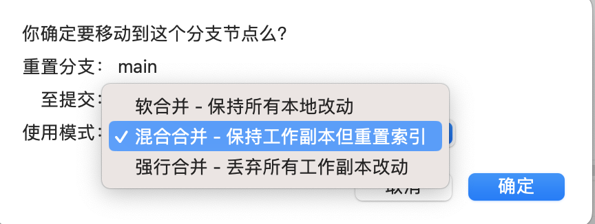

# Git命令

## clone

### clone某一次commit

克隆Git仓库的特定提交，需要先克隆整个仓库，然后使用`checkout`命令切换到特定的提交。以下是步骤：

1. 克隆整个仓库：

```bash
git clone <repository-url>
```

2. 切换到你的目标仓库：

```bash
cd <repository-name>
```

3. 使用`checkout`命令切换到特定的提交。你需要知道想要切换的提交的哈希值：

```bash
git checkout <commit-hash>
```

注意，当切换到一个特定的提交时，你会处于一个"DETACHED HEAD"状态。这意味着任何你做的改变都不会影响任何分支。如果你想要保存你的改变，你可以创建一个新的分支。

如果你想要创建一个新的分支来保存你所做的提交，你可以使用`git switch -c <new-branch-name>`命令来创建。

如果你想撤销这个操作，你可以使用 `git switch -` 命令来回到你之前的状态。

如果你不想再看到这个提示，你可以通过设置配置变量`advice.detachedHead`为`false`来关闭它。例如，运行 `git config --global advice.detachedHead false`。

## status

查看文件修改、暂存、未跟踪和冲突状态。常用简洁形式：

```bash
git status --short --branch
git status -sb  # 等价简写
```

`--short` 简洁显示文件状态，`--branch` 同时显示当前分支及其上游关系。

输出示例：

```text
## main...origin/main [ahead 1]
 M README.md
M  docs/git.md
?? notes.md
```

- `main...origin/main`：当前分支为 `main`，跟踪 `origin/main`。
- `ahead 1`：本地领先 1 个提交；`behind 2` 则表示落后 2 个提交。
- ` M`：修改未暂存；`M `：修改已暂存；`??`：未跟踪的新文件。

普通文件状态的第一列表示暂存区，第二列表示工作区。

### 在指定目录查看状态

无需先进入目标目录，可以用 `-C` 指定本次 Git 命令的执行位置。

```bash
WORKTREE_B_DIR="/path/to/project-requirement-b"
git -C "$WORKTREE_B_DIR" status --short --branch
```

注意使用大写 `-C`；小写 `-c` 用于临时传入 Git 配置。执行前应确保目录变量已设置且非空：`-C ""` 会沿用当前目录。[Git 官方说明](https://git-scm.com/docs/git#Documentation/git.txt--Cltpathgt)

## add 与 commit 速查

暂存区保存准备提交的内容。基本流程：**修改文件 → `git add` 暂存 → `git commit` 生成本地提交记录**。

| 命令 | 作用 |
| --- | --- |
| `git add 文件路径` | 将指定文件当前的新增、修改或删除放入暂存区，尚未提交 |
| `git add .` | 暂存当前目录及子目录中的新增、修改和删除；默认遵守忽略规则 |
| `git commit -m "说明"` | 提交暂存区内容，并指定提交说明 |
| `git commit -a` | 自动暂存所有已跟踪文件的修改和删除，再打开编辑器填写说明并提交 |
| `git commit -am "说明"` | 同时使用 `-a` 和 `-m`：自动暂存已跟踪文件的修改和删除，并按指定说明提交 |

**`-m` 指定说明，`-a` 自动暂存；`-a` 不会自动加入未跟踪的新文件，新文件仍需先 `git add`。**

常用示例：

```bash
# 暂存指定文件，再提交暂存区中的全部内容
git add README.md
git commit -m "docs: 更新 README"

# 自动暂存所有已跟踪文件的修改和删除，再提交
git commit -am "docs: 更新文档"
```

## push

git push origin master。提交到远程的master分支。

```sh
git push <远程主机名> <分支名>
```

如果需求分支尚未设置上游，第一次推送时使用 `git push -u` 建立跟踪关系。

```shell
git push -u origin "$NEW_BRANCH"
```

## fetch

获取远端最新提交和分支信息，同时清理过期的远端跟踪记录：

```bash
git fetch origin --prune
```

- `origin`：远程仓库名称。
- `--prune`：清理远端已删除分支在本地留下的跟踪记录。

## pull

`git pull` 先获取远程提交，再按指定策略整合到**当前分支**。[Git 官方说明](https://git-scm.com/docs/git-pull)

```bash
git pull              # 从当前分支已配置的上游分支拉取
git pull origin main  # 从 origin 的 main 分支拉取，整合到当前分支
```

执行前先提交或用 `git stash` 临时保存未完成的修改；`git pull origin main` 不会自动切换到本地 `main` 分支。

### 拉取代码报错

如果提示：

```text
fatal: Need to specify how to reconcile divergent branches.
```

表示本地分支和远程分支各有对方没有的提交，历史已经分叉，需要选择整合策略。按团队约定选择以下命令之一，仅对本次拉取生效：

| 策略 | 命令 | 效果 |
| --- | --- | --- |
| 合并（Merge） | `git pull --no-rebase` | 保留已有提交；分叉时创建合并提交 |
| 变基（Rebase） | `git pull --rebase` | 将本地提交重新应用到远程最新提交之后，会改写这些提交；避免用于已经共享的提交 |
| 仅快进（Fast-forward only） | `git pull --ff-only` | 仅允许快进更新；分叉时拒绝整合，不能用于解决上述报错 |

快进是直接把本地分支指针移动到远程的新提交，不产生合并提交。如果本地只是领先且已包含远程全部提交，则无需更新，并不属于分叉。

合并或变基仍可能产生冲突：修复冲突文件并用 `git add 文件路径` 暂存后，分别执行 `git merge --continue` 或 `git rebase --continue`；要取消本次操作，分别执行 `git merge --abort` 或 `git rebase --abort`。

### 设置默认拉取策略

在仓库目录执行对应配置，后续 `git pull` 会使用该默认策略，无需每次传入参数：

```bash
# 按团队约定选择一项，不要依次执行全部命令
git config set pull.rebase false  # 默认合并
git config set pull.rebase true   # 默认变基
git config set pull.ff only       # 仅允许快进
```

如果已经设置了 `pull.ff=only`，改为允许合并或变基时，还需执行 `git config set pull.ff true`，解除仅快进限制。

若要设置所有仓库的默认值，添加 `--global`，例如 `git config set --global pull.rebase false`。[Git 配置说明](https://git-scm.com/docs/git-config)

## tag

- `git tag`：查看所有tag。
- `git tag 0.1.0`：打tag。
- `git push --tags`：提交tag到远程。

## branch

- `git branch`：列出你在本地的分支。
- `git branch (branchname)`：创建分支
- `git checkout (BranchName)`：切换到要修改的分支。

### merge

`git merge --no-ff '3.3.0'`：将3.3.0分支合并到当前分支。

```sh
git fetch origin
//先切换到主分支
git checkout 'main'
//将3.3.2分支合并到main分支，并且会创建一个新的合并提交，即使可以进行快速前进合并。
git merge --no-ff '3.3.2'
//将目标分支推送到 GitLab。
git push origin 'main'
```

**详细解释**

- **Fast-Forward（快速前进）**：
  - 如果目标分支（例如 `main`）直接位于源分支（例如 `feature`）的历史之前，Git 默认会执行快速前进合并。这种合并方式不会创建新的合并提交，只是简单地将目标分支的指针移动到源分支的最新提交。
- **Non-Fast-Forward（非快速前进）**：
  - 使用 `--no-ff` 选项，Git 会创建一个新的合并提交。这种方式会保留分支的合并历史，明确显示合并点。

**示例**

假设你有以下分支结构：

```
A---B---C (main)
     \
      D---E (feature)
```

如果你在 `main` 分支上执行 `git merge feature`：

- **默认（快速前进）**：
  
  - 结果是 `main` 分支直接移动到 `E`，提交历史变为：
    ```
    A---B---C---D---E (main)
    ```
  
- **使用 `--no-ff`**：
  
  - 结果是创建一个新的合并提交 `M`，提交历史变为：
    ```
    A---B---C---M (main)
             / \
            D---E
    ```

使用 `--no-ff` 可以更清晰地记录分支合并的历史，可以帮助更好地理解代码的演变过程。

### stash

不在当前分支上commit和push，将修改在其它分支上进行commit和push。

1. **暂存当前修改**：
   
   ```bash
   git stash  # 将未提交的修改暂存起来
   ```
   
2. **创建并切换到新分支**：
   
   ```bash
   git checkout -b new-feature-branch
   ```
   
3. **恢复暂存的修改**（如果执行了 stash）：

   ```bash
   git stash pop  # 将暂存的修改应用到新分支
   ```

4. **提交修改**：
   在新分支上提交你的修改。

   ```bash
   git add .
   git commit -m "Your commit message"
   ```

这样，你就可以在新的分支上进行提交和推送，而不会影响到 `develop` 分支。

## reset

`git reset --hard efa965834671bd20a19c049b572b647fc07613c4`会回退到`efa965834671bd20a19c049b572b647fc07613c4`这次提交，后面的提交在本地没有了，但是可以拉取。



## revert

**撤销普通提交**

```sh
git revert <commit_id>
```

**撤销分支合并提交**

```sh
git revert -m 1 abc1234  # 替换为实际的提交哈希
```

- `-m 1` 表示接收合并的分支，即你的 release 分支
- `-m 2` 表示被合并的分支，即 develop 或 feature/inform

## 舍弃本地修改

| 命令            | 作用                                                   |
| --------------- | ------------------------------------------------------ |
| `git restore .` | 撤销当前目录下所有已跟踪文件的本地修改                 |
| `git clean -fd` | 删除所有未跟踪的文件和文件夹（-f 强制，-d 包含文件夹） |

## cherry-pick

正常的流程是在Feature分支上开发，然后合到Develop分支。
但是我不小心在Develop分支上进行了开发，提交push到Develop，现在Feature分支上面没有刚才修改的代码。

可以用 **cherry-pick**。把你误提交到 `Develop` 的那几个 commit，单独拣到 `Feature` 分支上。

1. 切到 Develop，找到误提交的 commit，记下你刚才提交的 commit hash。
2. 切到 Feature，把 Develop 上误提交的 commit 拣过来

```bash
# 把 develop 上误提交的 commit 拣过来
git cherry-pick abc1234
git cherry-pick def5678
```

如果这几个 commit 是连续的，也可以：

```bash
git cherry-pick 起始commit^..结束commit
```

例如：

```bash
git cherry-pick abc1234^..def5678
```

然后推送：

```bash
git push origin Feature
```
