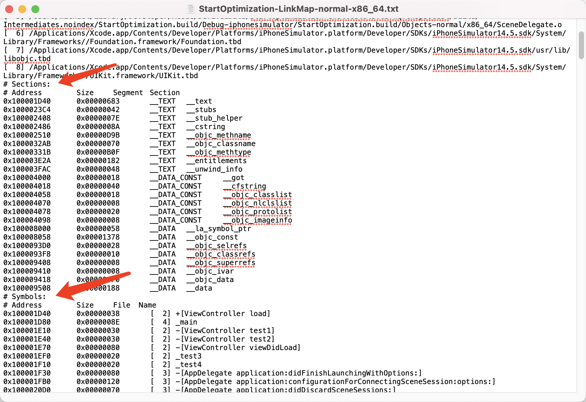

# iOS 启动优化：基础原理与操作指南

## 基础原理与面试回答

### 1. APP 从启动到显示页面，经历了什么

以采用 Scene 生命周期的 UIKit APP 为例，可以按下面的主线理解：

```text
创建进程、装载主程序与依赖
→ 完成必要的地址修正、运行时准备与启动初始化
→ 进入 main / UIApplicationMain
→ AppDelegate、SceneDelegate 等启动回调
→ 创建窗口和根控制器，完成布局与绘制
→ 首帧显示，继续完成业务数据加载
```

这是理解流程的主线，各阶段的实现可能交织或经过系统预处理，不应背成所有系统版本都完全相同的内部调用顺序。Swift 的 `@main` 可以生成入口，不代表没有启动入口。

| 阶段 | 主要工作 | 常见优化方向 |
| --- | --- | --- |
| `pre-main`：进入 main 前 | 主程序和依赖的装载、必要的地址修正、Objective-C Runtime 准备、启动时需要执行的初始化 | 减少不必要依赖和初始化工作，测量代码装载开销 |
| `main` 后到首帧 | 应用和场景初始化、创建窗口与页面、布局绘制 | 控制主线程工作量，优先准备首屏必需内容 |
| 首帧后的业务准备 | 登录状态恢复、接口请求、图片和内容展示等；具体也可能与首帧前工作重叠 | 分开记录页面可操作和内容完成时间，避免只优化一个空白外壳 |

**首帧、首页可操作、内容加载完成是不同指标。** `viewDidLoad` 只说明控制器开始准备视图；`viewDidAppear` 也不能直接代替屏幕实际呈现首帧的时间。系统还可能预热进程，因此“进程创建到现在”的时长未必等于用户点击图标后的等待时间。[Apple：应用启动过程](https://developer.apple.com/documentation/uikit/about-the-app-launch-sequence)

### 2. dyld 和 pre-main 的几个核心概念

`dyld` 是动态链接器，负责装载主程序及动态依赖，并协调必要的地址修正和初始化。理解启动时，常会遇到以下名词：

| 名词 | 大白话解释 |
| --- | --- |
| Image / 镜像 | 一份装载进进程的 Mach-O，例如主程序或动态库；这里不是图片 |
| Dylib loading / 动态库装载 | 建立程序与依赖的内存映射，准备执行所需代码；映射不代表所有文件内容立即读入物理内存 |
| Rebase / 基址修正 | 镜像实际装载位置变化后，修正需要随之变化的地址引用 |
| Bind / 符号绑定 | 把对外部函数、变量等符号的引用，关联到对应的实际地址 |
| Objective-C Runtime 准备 | 处理类、分类、选择子等元数据，使 Objective-C 的运行机制能够工作 |
| Initializers / 初始化器 | 启动时装载的镜像中需要执行的 `+load`、C/C++ 构造函数等 |

链接器在**构建阶段**组合目标文件和库，生成最终 Mach-O；dyld 在**装载与运行阶段**处理动态链接相关工作。现代系统会利用缓存、预计算等机制减少现场工作，不能假定每次启动都把所有绑定步骤重新做一遍。[Apple：dyld4 实现说明](https://github.com/apple-oss-distributions/dyld/blob/main/doc/dyld4.md)

关于初始化，面试时要把边界说清楚：

- `+load` 是启动时可能执行用户代码的入口之一，不能说它一定是整个程序最早执行的用户代码。依赖库中也可能有初始化代码。
- 对启动阶段已经装载的镜像，`+load` 可以在 `main` 前执行；之后动态装载的镜像也可能触发自己的 `+load`。
- `__attribute__((constructor))` 标记的函数、C++ 静态对象的构造也属于需要关注的初始化；不要假设它们与所有 `+load` 存在一条通用的全局先后顺序。[Apple：动态库初始化](https://developer.apple.com/library/archive/documentation/DeveloperTools/Conceptual/DynamicLibraries/100-Articles/DynamicLibraryDesignGuidelines.html)
- 不要把所有语言的全局、静态属性都算成 `pre-main` 成本；Swift 全局变量采用懒初始化，成本要看首次访问发生在哪里。[Apple：Swift 全局变量初始化](https://developer.apple.com/videos/play/wwdc2024/10169/)

优化重点是减少和推迟非必要工作。例如，首页不需要的 SDK 准备、文件扫描或业务对象初始化可以在合适时机执行，但必须保留其线程要求、隐私门禁和业务依赖。

### 3. 冷启动、暖启动与恢复，有什么区别

| 情况 | 如何理解 | 测量时注意 |
| --- | --- | --- |
| 较冷的启动 | 需要重新创建进程，启动依赖的代码页、文件缓存等准备较少 | 重启设备后的首次启动是常见观察场景；仍受系统预热等因素影响 |
| 较暖的启动 | 同样可能重新创建进程，但相关代码页或数据仍有缓存 | 强制退出后马上重新打开，往往属于这一类 |
| 从后台恢复 | 进程仍存活，从挂起或后台状态回到前台 | 一般不会重走整个 pre-main，应单独测恢复时间 |

冷暖程度是连续变化的，不能只凭“进程刚被杀掉”就认定是完全冷启动。系统保留的文件缓存可能让重新装载更快；后台 APP 若已被终止，再次打开则需要重新启动。[Apple：启动优化与冷热条件](https://developer.apple.com/documentation/xcode/reducing-your-app-s-launch-time)

### 4. Mach-O、Link Map 和地址分别是什么

#### 4.1 Mach-O 中的 Segment 和 Section

Mach-O 是 Apple 平台使用的目标文件、可执行文件及动态库格式。Segment（段）描述较大的映射区域，Section（节）进一步组织某类代码或数据。

| 常见 Segment | 内容和特点 |
| --- | --- |
| `__TEXT` | 代码以及部分只读数据；并非只包含函数指令 |
| `__DATA` | 运行期间需要修改的数据 |
| `__DATA_CONST` | 通常在完成地址修正后设为只读的数据；不能简单理解为普通可写变量区 |
| `__LINKEDIT` | 符号、动态链接、代码签名等相关信息 |
| `__PAGEZERO` | 主程序中可能存在的不可访问虚拟地址区域，用于防护低地址访问，不占用同等大小的文件内容 |

具体段和权限以当前二进制为准。`__TEXT,__text` 表示 `__TEXT` 段里的 `__text` 节；同一个段还可以包含其他节。[Apple：Mach-O 格式](https://developer.apple.com/library/archive/documentation/Performance/Conceptual/CodeFootprint/Articles/MachOOverview.html)

#### 4.2 Link Map 能看到什么

Link Map 是链接器输出的布局清单，主要帮助确认“哪些符号最终被放在什么位置”。Xcode 中开启 `Write Link Map File`，具体输出位置看 `LD_MAP_FILE_PATH`，不要依赖某台电脑的固定 DerivedData 路径。

| 区域或字段 | 含义 |
| --- | --- |
| `Object files` | 参与链接的目标文件及其索引 |
| `Sections` | 节的链接虚拟地址、大小、所属 Segment 和 Section |
| `Symbols` | 最终符号的地址、大小、来源和名称；既可能是函数，也可能是数据 |
| `Address` | 链接时安排的虚拟地址 |
| `Size` | 占用的字节数，清单中通常按十六进制显示 |
| `File` | 对应目标文件的索引，可回查 Object files |
| `Name` | 链接符号名；Swift 通常保留编码后的名称 |
| `Dead Stripped Symbols` | 被链接器移除的符号，不能当作最终仍存在的布局来使用 |

下面的截图用于识别字段，来自 x86_64 模拟器示例；其中的路径和数值不是当前课堂项目的性能数据。实际操作应查看本次 Release arm64 构建的文件。



**Link Map 显示存放位置，不记录执行先后。** 文件顺序、编译优化、内联、链接优化及 order 文件都会影响布局。源码中的一个方法也不保证在最终二进制中对应一个独立、同名的函数。

#### 4.3 文件偏移、链接地址、运行时地址

| 概念 | 含义 |
| --- | --- |
| 文件偏移 File Offset | 从 Mach-O 文件开头数多少字节 |
| 链接虚拟地址 Linked Address | 链接器为代码或数据安排的虚拟地址，Link Map 的 Address 属于这一类 |
| 运行时地址 Runtime Address | 程序实际装载后，在当前进程里的地址 |
| ASLR slide | 地址空间布局随机化（Address Space Layout Randomization）产生的装载偏移 |

对同一镜像中的地址，可以这样换算：

```text
运行时地址 = 链接虚拟地址 + 该镜像的 ASLR slide
链接虚拟地址 = 运行时地址 - 该镜像的 ASLR slide
```

若还要换成文件偏移，需要找到所在 Segment，利用它的 `vmaddr` 和 `fileoff` 换算；零填充等区域未必有对应的文件字节。不要直接把文件偏移加上 slide 当成运行时地址。[Apple：符号化与地址换算](https://developer.apple.com/videos/play/wwdc2021/10211/)

### 5. 虚拟内存、分页、缺页和进程终止

#### 5.1 虚拟地址与物理内存

APP 使用的是自己的虚拟地址空间，系统通过页表把虚拟地址映射到物理内存或其他受管理的区域。虚拟地址空间的大小、实际占用的物理内存、APP 可使用的内存上限是不同概念。

32 位地址的理论寻址范围是 `2^32` 字节，即 4GiB；当前 64 位 APP 不能套用“每个 APP 固定只有 4GB 虚拟地址空间”的说法。64 位也不代表可以使用任意大小的物理内存。访问未映射或不允许访问的地址，可能导致 `EXC_BAD_ACCESS`。[Apple：虚拟内存系统](https://developer.apple.com/library/archive/documentation/Performance/Conceptual/ManagingMemory/Articles/AboutMemory.html)

#### 5.2 分页与 Page Fault

系统以页为单位管理内存。现代 iPhone 常见的页大小是 16KiB；跨架构、跨设备或模拟器编程时应查询实际页大小，例如使用 `getpagesize()`，而不是把它当作所有环境的常数。[Apple：内存页与内存占用](https://developer.apple.com/videos/play/wwdc2022/10106/)

Page Fault（缺页异常）是访问地址时，由于页面尚未准备好或访问条件不满足而触发的异常处理机制。它不一定是程序 Bug，也不一定需要读取存储：

- 某些情况可以利用已经存在的物理页、缓存或建立映射来解决。
- 某些情况需要把可执行文件等内容读入内存，等待成本更高。
- 无法合法处理的访问，可能转化为进程错误，而不是成功补一页后继续。

发生异常的是执行该访问的线程；不能一概说整个进程都会停止。二进制重排主要关注启动需要触及的代码页，只有相关装载开销实际存在时才可能获益。

#### 5.3 内存回收与 Jetsam

内存紧张时，系统可以回收可重新读取的文件页等资源；在内存压力或进程内存限制等条件下，还可能终止进程。iOS 的这类终止可以通过 Jetsam 事件报告排查。

打开多个 APP 后再返回某个 APP，如果它重新启动，不能仅凭这一现象判定“发生了页面置换”。应区分原进程是否还存在、页面资源是否需要重建，以及进程是否被系统终止。[Apple：Jetsam 事件报告](https://developer.apple.com/documentation/xcode/identifying-high-memory-use-with-jetsam-event-reports)

关于进程通信，只需在这里记住：各进程有各自的地址空间，共享部分系统代码页不等于可以任意访问其他 APP 的业务数据。跨进程交换数据要使用系统允许的通信或共享机制，不能把 dyld 共享缓存当成业务数据通道。

### 6. 二进制重排为什么可能加快启动

同一个源文件里的代码可能包含启动函数，也包含很晚才使用的函数。若启动函数散落在多个代码页里，为了执行少量启动代码，系统可能需要准备较多页面。

假设几个启动函数足够小，可以用这个示意理解布局变化：

```text
重排前：第 1 页 [启动函数 A + 后续业务代码]
        第 2 页 [启动函数 B + 后续业务代码]
        第 3 页 [启动函数 C + 后续业务代码]

重排后：第 1 页 [启动函数 A + 启动函数 B + 启动函数 C]
        后续页 [其他业务代码]
```

把相关代码放得更集中，有机会让启动触及更少代码页。示意中的“3 页变 1 页”不是实际项目的承诺，函数大小、对齐、缓存状态和链接器行为都会影响结果。

order 文件逐行列出链接符号。链接器按清单安排同一个输出 section 中可排序符号的布局；它改变存放位置，函数何时执行仍由原来的调用逻辑决定。[Apple：order_file](https://github.com/apple-oss-distributions/ld64/blob/main/doc/man/man1/ld-classic.1)

需要区分几件事：

- 重排不会减少业务算法本身的计算量，也不能缩短服务器处理时间。
- 主 APP 的 order 文件不能直接改变独立动态 framework 内部的布局；静态库代码若参与本次链接，则需看具体符号是否可排序。
- 冷暖条件不同，收益可能不同；已经驻留的代码页不需要再次从存储读取。
- 除了启动，还要检查主要页面第一次打开是否退化。是否保留重排，以重复测量结果为准。

### 7. 怎么找到启动实际执行的函数

**基本思路：采集运行路径 → 得到符号清单 → 关闭采集并按清单重新链接 → 真机测量。** 本文使用编译器插桩获取路径，也可以使用专门的调试或分析工具；它不是唯一的采集方式。

Clang 的 SanitizerCoverage 可以在编译时插入回调。粒度不同，记录的内容也不同：

| 粒度 | 记录位置 |
| --- | --- |
| `func` | 编译器处理后的函数入口，适合本教程的函数排列采集 |
| `bb` | 基本块，即没有内部控制流分叉的一段指令 |
| `edge` | 控制流边，用于更细的覆盖分析；部分点可能被编译器裁剪 |

C、Objective-C、C++ 的示例参数是：

```text
-fsanitize-coverage=func,trace-pc-guard
```

| 回调 | 实际含义 |
| --- | --- |
| `__sanitizer_cov_trace_pc_guard_init` | 初始化某段插桩 guard 数组；可能针对不同模块调用，数组长度不是整个项目的符号总数 |
| `__sanitizer_cov_trace_pc_guard` | 执行到对应插桩点时调用，可记录当前调用位置；是否只保存首次出现由采集器控制 |

只有参与插桩并实际执行到的代码才会被记录。预编译 SDK、未开启插桩的 target、未经过的业务分支不会自动完整出现；优化与内联也会改变函数形态。因此“这次没记录到”不能用作删除代码的充分理由。[Clang：SanitizerCoverage](https://clang.llvm.org/docs/SanitizerCoverage.html)

Swift 需要单独设置 Swift 编译参数，不能仅靠 Other C Flags 覆盖。当前工具链使用的完整参数、额外运行库检查和清理步骤见下半部分第 3、8、9 节。采集器本身应排除插桩，避免回调递归；带采集代码的包不用于性能对比。

### 8. 启动优化的顺序与面试回答

按“测量 → 找主因 → 做最小调整 → 对比”的顺序处理：

1. **先明确目标。** 分开观察首帧、可操作和内容完成，区分较冷启动、较暖启动与恢复。
2. **定位真实耗时。** 使用 Instruments App Launch、Time Profiler、dyld Activity 等信息判断是在装载、执行计算、阻塞等待还是界面准备阶段耗时。
3. **减少首屏前的必要工作量。** 延后非必要初始化；耗时 I/O 和解析在满足线程安全的前提下离开主线程，UI 更新仍遵循主线程要求。
4. **控制并发和依赖。** 无依赖任务可以适当并行，但线程过多会增加调度和争用。动态库按实际成本决定是否合并或调整链接方式，不能只按固定数量处理。
5. **改善内容展示。** 可用骨架屏、明确的加载状态或有效缓存，避免用虚构业务数据冒充真实内容。
6. **最后验证。** 两个对比包使用相同的 Release 优化和测量条件，关闭临时采集，检查目标指标及其他页面是否退化。[Apple：Optimizing App Launch](https://developer.apple.com/videos/play/wwdc2019/423/)

`DYLD_PRINT_STATISTICS` 这类诊断输出随系统和运行环境变化，不作为本文的主要测量入口。读任何日志都先看单位：**milliseconds（ms）是毫秒，seconds（s）是秒，1000ms = 1s**；例如 `69.53 milliseconds = 0.06953 seconds`。这是单位换算示例，不是当前项目的启动成绩。

**面试时可以这样回答：**

> 我会先确定要优化的是首帧、首页可操作还是内容加载完成，并区分冷暖启动和后台恢复。然后用 Instruments 看耗时主要落在 dyld 装载与初始化、主线程业务处理，还是布局与网络等待。优先减少和延后首屏不需要的工作，再按测量结果调整依赖和并发。如果代码装载确实占比较高，可以采集启动函数，通过 order 文件把相关代码排得更集中，减少需要触及的代码页。最后用关闭插桩的 Release 包在真机做重复对比，并确认其他功能和页面没有退化。

追问时重点说明：`+load` 不是通用的最早用户代码；Link Map 记录布局而非调用顺序；缺页不一定读取存储；重排不改变业务调用顺序；没有实测就不能报具体提升比例。项目经验只讲自己真正执行和验证过的部分。

## 测量与二进制重排操作指南

本文以柠檬云课堂 `AccCollege` 为例，说明如何完成 **测量现状 → 采集启动函数 → 生成 order 文件 → 重新编译 → 验证收益 → 清理采集配置**。其他项目按文中的替换表调整即可。

核对环境：2026-11-02，Xcode 27.2（27B52）、Apple Swift 6.4.2、Apple Clang 21。本机已验证 ObjC/Swift 混合小型示例的插桩、导出、符号转换和重排，以及最小 Xcode 工程的 iOS arm64 构建；课堂 APP 的真机采集、签名安装、性能收益需要按本文实际执行，不能视为已经通过。

## 操作导航

| 顺序 | 要做什么 | 完成标志 |
| --- | --- | --- |
| 1 | 明确测量范围，保存原始数据 | 有设备、构建和启动耗时记录 |
| 2 | 配置采集构建，加入临时采集代码 | 编译成功，且仅主 APP 开启采集 |
| 3 | 真机启动，导出地址记录 | 得到本次构建的 `startup-pcs.txt` 和 Link Map |
| 4 | 地址转换为符号排列文件 | 生成非空的 `startup.order` |
| 5 | 关闭采集，用 order 文件重新构建 | 无采集参数，链接时正确读取 order 文件 |
| 6 | 核对排列，进行真机 A/B 对比 | 有原始包和重排包的重复测量结果 |
| 7 | 保留有效配置，清理或回退 | 正式包没有采集运行库，能够正常归档 |

## 1. 先确定要优化的时间

### 1.1 三个时间点分别记录

| 时间点 | 含义 | 检查方式 |
| --- | --- | --- |
| 首帧显示 | APP 首个界面真正画到屏幕上 | Instruments 的 App Launch；不要用 `viewDidLoad` 时间代替 |
| 首页可操作 | 启动检查结束，进入首页且能操作 | 单独观察或给明确的业务完成事件加测量标记 |
| 首页内容完成 | 本次定义的必要接口、图片已显示 | 单独记录网络与渲染时间，不混入代码加载收益 |

课堂当前先显示启动界面，再经过隐私和安全检查，最后进入业务首页。因此“首帧快了”不等于“首页内容全部更快了”。首次安装时用户阅读协议、输入验证码的时间另算，不纳入代码加载优化成绩。

启动大致分为：系统装载程序及依赖、执行初始化代码、进入 `main` 和 UIKit 生命周期、创建首个界面。可以用 Instruments 观察装载和初始化阶段，不应只依赖一条控制台打印。

### 1.2 二进制重排的作用

程序文件中的函数有各自的位置，系统按内存页加载所需代码。把启动时常用的函数放得更集中，有机会减少启动需要触及的代码页，降低装载开销。`order file` 是“符号名称排列清单”，链接器根据它安排函数和数据的布局；业务调用顺序不变。

收益主要取决于代码分页是否构成实际瓶颈。它不能减少服务器等待、替代耗时算法优化，也不能证明未采集到的函数可以删除。内存页大小应以目标设备为准，不写死为所有平台都相同。

主 APP 的 order 文件只控制这次链接的输出。独立动态 framework 要单独处理；本教程不改 CC/HDS 厂商内部代码，也不尝试重排预编译动态 SDK。

原理参考：[Apple 链接器的 order_file 说明](https://github.com/apple-oss-distributions/ld64/blob/main/doc/man/man1/ld-classic.1)、[Sentry 对代码分页与 order 文件的说明](https://sentry-blog.sentry.dev/open-source-tool-speed-up-ios-app-launch/)。

## 2. 准备项目并测量原始包

### 2.1 确定工程、Scheme 和设备

| 项目 | 课堂项目示例 | 换项目时替换什么 |
| --- | --- | --- |
| 工作目录 | `/Users/michael/Desktop/yuncai/kjxy/refactor2.0/AccCollege` | 包含 `.xcworkspace` 的目录 |
| Workspace | `AccCollege.xcworkspace` | 实际 workspace；使用 CocoaPods 时不要只打开 xcodeproj |
| 主 APP Scheme / Target | `AccCollege` | 真机发布对应的主 APP |
| 业务首屏 | `ACNewHomeController` | 要采集到哪个页面 |
| 构建配置 | `Release` | 与正式发布一致的优化设置 |
| 运行设备 | 已解锁、启用开发者模式、完成配对的真机 | 固定一台设备，记录型号及系统版本 |

课堂的 `AccCollegeSimulator` 会关闭部分 SDK，不能代替正式 target 的真机数据。本教程使用 `AccCollege`；登录和查看首页即可，不操作购买、删除等会改变业务数据的功能。

操作前查看 `git status`，记录当前提交和已有改动；建议在独立优化分支操作，不覆盖未提交代码。本文只需要主 APP 的构建设置，不修改 Pods 生成配置，也不更改最低系统版本。

```bash
cd "/Users/michael/Desktop/yuncai/kjxy/refactor2.0/AccCollege"
open "AccCollege.xcworkspace"
xcodebuild -version
xcrun swiftc --version
python3 --version
```

转换脚本使用 Python 3.9 或更高版本；不需要安装第三方 Python 包。

### 2.2 使用 Instruments 保存基线

1. 在 Xcode 顶部选择 `AccCollege` 和这台真机。
2. 打开 **Product → Scheme → Edit Scheme → Profile**，确认 Build Configuration 为 `Release`。课堂当前 Profile 已配置为 Release；Run 默认仍是 Debug，二者不要混淆。
3. 确保没有启用 Address Sanitizer、Thread Sanitizer、额外启动日志或本教程的采集参数。
4. 执行 **Product → Profile**（⌘I），选择 **App Launch** 模板。选择由 Instruments 启动 APP，而不是连接已经启动的进程。
5. 录制到首页可操作后停止，保存 `.trace`。查看启动耗时、主线程忙碌/阻塞区间以及 dyld 初始化活动。
6. 把同一次构建的 APP、dSYM、提交号、Xcode 版本、设备和登录状态记下来。后面原始包 A 与重排包 B 使用相同的测量工具和设置。

先采几次定位瓶颈；最终对比建议每组至少做 10 次重复启动并保留原始记录。重复强退再启动通常属于较暖的启动条件，不能标成“10 次完全冷启动”。另做重启设备后首次启动的对比，并单独记录；系统缓存、预热和设备温度仍会影响结果。

如果主要时间花在网络等待、磁盘读写或大量初始化计算，先针对这些实际耗时优化。不要因为存在大量函数，就断言重排一定有明显收益。

测量方法参考：[Apple：Reducing your app’s launch time](https://developer.apple.com/documentation/xcode/reducing-your-app-s-launch-time)。

## 3. 配置专门用于采集的构建

本教程临时调整**主 APP Target 的 Release 设置**。不新建 CocoaPods 构建配置，完成采集后逐项恢复。先截图或记录这些字段原值；已有的 `$(inherited)`、宏和参数都要保留。

### 3.1 建立文件位置

在 workspace 所在目录执行：

```bash
mkdir -p "StartupTrace/Artifacts"
mkdir -p "AccCollege/ACClasses/Diagnostics/StartupTrace"
```

文件用途：

```text
AccCollege/ACClasses/Diagnostics/StartupTrace/
  ACStartupTrace.h              # 临时采集接口
  ACStartupTrace.m              # 记录首次调用地址
StartupTrace/
  make_order.py                 # 地址转换工具，只在 Mac 上运行
  capture-LinkMap.txt           # 采集构建产生，下一次构建可能覆盖
  startup.order                # 最终链接使用的符号排列清单
  Artifacts/
    startup-pcs.txt             # 从真机导出的采集记录
    capture-LinkMap.txt         # 与采集记录配套的冻结副本
    Capture.app/                # 采集时的 APP，供 UUID 校验
```

原始地址、Link Map、APP、dSYM、trace 等是本地分析产物，不加入正式 APP 的资源。需要提交时只保留经过检查的 order 文件、必要工具和构建配置；采集产物可以在 `.git/info/exclude` 中本地忽略。

### 3.2 在主 APP Target 的 Build Settings 中配置

切到 **All + Levels**，展开各字段，只改主 APP 的 `Release` 值。下表的 `$(inherited)` 表示保留原有设置，并不是让你删除之前的值。

| 设置名称 | 采集阶段的值 | 用途 |
| --- | --- | --- |
| Write Link Map File / `LD_GENERATE_MAP_FILE` | `YES` | 保存函数名称与链接地址；课堂当前已开启 |
| Path to Link Map File / `LD_MAP_FILE_PATH` | `$(PROJECT_DIR)/StartupTrace/capture-LinkMap.txt` | 固定这次 arm64 真机采集的输出位置 |
| Order File / `ORDER_FILE` | 空 | 先采集未经本次重排的布局 |
| Enable Debug Dylib Support / `ENABLE_DEBUG_DYLIB` | `NO` | 让被采集代码位于主可执行文件；后续 A/B 也保持同值 |
| Preprocessor Macros / `GCC_PREPROCESSOR_DEFINITIONS` | 原值后新增 `AC_STARTUP_TRACE=1` | 仅采集时编译记录代码和导出入口 |
| Other C Flags / `OTHER_CFLAGS` | 原值后新增 `-fsanitize-coverage=func,trace-pc-guard` | 记录 ObjC/C 函数入口 |
| Other C++ Flags / `OTHER_CPLUSPLUSFLAGS` | 原值后新增同一参数；确认最终值没有重复 | 记录由主 target 编译的 C++/ObjC++ |
| Other Swift Flags / `OTHER_SWIFT_FLAGS` | 原值后新增 `-sanitize=undefined -sanitize-coverage=func,trace-pc-guard` | 记录 Swift 函数入口 |

这些参数只放在主 APP，不向工程级或所有 Pods 扩散。源码中没有相关语言时，可以不加对应参数。

**Swift 参数是采集专用。** 当前 Swift 6.4.2 的最小示例已验证：只有 coverage 参数会报需要 sanitizer，配合上表参数可以生成回调。是否引入 `libclang_rt.ubsan_ios_dynamic.dylib` 取决于最终链接方式，按第 9 节检查实际产物，不能只看编译参数判断。采集包不能当作性能基线，也不能直接发布；之后必须移除采集参数和本次引入的运行库依赖再比较。

默认按表中配置，不额外开启其他诊断器。若另行开启了 Scheme → Run → Diagnostics → **Undefined Behavior Sanitizer**，Xcode 会管理相应运行库的嵌入；完成采集后也要关闭这个开关。遇到缺库错误时按第 11 节处理，不手动把采集运行库加入长期业务依赖。参见 [Apple：运行时诊断工具](https://developer.apple.com/documentation/xcode/diagnosing-memory-thread-and-crash-issues-early)。

版本升级后先用小项目检查参数是否仍有效，不要为了通过编译随意换成 Address Sanitizer 或其他选项，再把结果当作正式包耗时。参考：[Clang SanitizerCoverage](https://clang.llvm.org/docs/SanitizerCoverage.html)、[Swift 对 coverage 与 sanitizer 的校验实现](https://github.com/swiftlang/swift/blob/main/lib/Option/SanitizerOptions.cpp)。

## 4. 添加采集代码

将下面两个文件创建在第 3 节指定目录，通过 Xcode 加入工程。只勾选主 APP `AccCollege` 的 Target Membership，不加入通知扩展或测试 target。

采集回调可能早于 `main` 执行，因此只使用预先分配的 C 数据和静态锁，不在每次回调中创建对象、写日志或解析符号。多线程调用按记录锁获得的先后保存；该记录用于布局参考，不能当成精确的线程调度时间线。

### 4.1 ACStartupTrace.h

```objc
#import <Foundation/Foundation.h>

#if defined(AC_STARTUP_TRACE) && AC_STARTUP_TRACE
/// 只调用一次；调用即冻结采集，写入失败后需重新启动采集。
FOUNDATION_EXPORT BOOL ACStartupTraceWrite(NSURL *destination, NSError **error);
#endif
```

### 4.2 ACStartupTrace.m

```objc
#import "ACStartupTrace.h"
#if defined(AC_STARTUP_TRACE) && AC_STARTUP_TRACE
#import <dlfcn.h>
#import <mach-o/dyld.h>
#import <mach-o/loader.h>
#import <pthread.h>
#import <uuid/uuid.h>

#define AC_NO_COVERAGE __attribute__((no_sanitize("coverage")))
// shortcut: 固定上限仅用于本地采集；溢出时明确失败，扩大后重新采集。
#define AC_TRACE_CAPACITY 131072
static pthread_mutex_t traceLock = PTHREAD_MUTEX_INITIALIZER;
static uint32_t nextGuard;
static unsigned char seen[AC_TRACE_CAPACITY];
static uintptr_t addresses[AC_TRACE_CAPACITY];
static size_t addressCount;
static BOOL stopped;
static BOOL overflowed;

AC_NO_COVERAGE
void __sanitizer_cov_trace_pc_guard_init(uint32_t *start, uint32_t *end) {
    if (start == end) { return; }
    pthread_mutex_lock(&traceLock);
    if (*start == 0) {
        for (uint32_t *guard = start; guard < end; ++guard) {
            if (nextGuard + 1 < AC_TRACE_CAPACITY) {
                *guard = ++nextGuard;
            } else {
                overflowed = YES;
            }
        }
    }
    pthread_mutex_unlock(&traceLock);
}

AC_NO_COVERAGE
void __sanitizer_cov_trace_pc_guard(uint32_t *guard) {
    uintptr_t pc = (uintptr_t)__builtin_extract_return_addr(__builtin_return_address(0));
    pthread_mutex_lock(&traceLock);
    uint32_t index = *guard;
    // guard 初始化后不再修改，避免与编译器生成的 guard 读取发生竞争。
    if (!stopped && index > 0 && index < AC_TRACE_CAPACITY && !seen[index]) {
        seen[index] = 1;
        addresses[addressCount++] = pc;
    }
    pthread_mutex_unlock(&traceLock);
}

AC_NO_COVERAGE
static BOOL traceFailure(NSError **error, NSString *message) {
    if (error) {
        *error = [NSError errorWithDomain:@"ACStartupTrace" code:1
                                userInfo:@{NSLocalizedDescriptionKey: message}];
    }
    return NO;
}

AC_NO_COVERAGE
BOOL ACStartupTraceWrite(NSURL *destination, NSError **error) {
    if (!NSThread.isMainThread || !destination.isFileURL) {
        return traceFailure(error, @"请在主线程传入本地文件 URL");
    }
    pthread_mutex_lock(&traceLock);
    BOOL wasStopped = stopped;
    BOOL wasOverflowed = overflowed;
    stopped = YES;
    pthread_mutex_unlock(&traceLock);
    if (wasStopped) { return traceFailure(error, @"本进程已经结束采集，请重新启动"); }

    // 失败不能留下旧结果，让下一步误把旧文件当作新采集。
    NSFileManager *manager = NSFileManager.defaultManager;
    if ([manager fileExistsAtPath:destination.path] &&
        ![manager removeItemAtURL:destination error:error]) { return NO; }
    if (wasOverflowed) { return traceFailure(error, @"采集容量不足，请扩大上限并重新运行"); }
    const struct mach_header_64 *header = (const void *)_dyld_get_image_header(0);
    if (header->magic != MH_MAGIC_64) { return traceFailure(error, @"仅支持 64 位主程序"); }
    const struct load_command *command = (const void *)(header + 1);
    NSString *binaryUUID = nil;
    for (uint32_t i = 0; i < header->ncmds; ++i) {
        if (command->cmd == LC_UUID) {
            char value[37];
            uuid_unparse_lower(((const struct uuid_command *)command)->uuid, value);
            binaryUUID = [NSString stringWithUTF8String:value];
            break;
        }
        command = (const void *)((const char *)command + command->cmdsize);
    }
    if (!binaryUUID) { return traceFailure(error, @"主程序缺少 UUID"); }
    NSMutableString *text = [NSMutableString stringWithFormat:@"# uuid=%@\n", binaryUUID];
    intptr_t slide = _dyld_get_image_vmaddr_slide(0);
    NSUInteger written = 0;
    for (size_t i = 0; i < addressCount; ++i) {
        Dl_info info;
        uintptr_t pc = addresses[i] - 1; // 返回地址退 1，保证仍处于调用函数范围内。
        if (dladdr((const void *)pc, &info) && info.dli_fbase == (const void *)header) {
            [text appendFormat:@"0x%llx\n", (unsigned long long)(pc - slide)];
            ++written;
        }
    }
    if (written == 0) { return traceFailure(error, @"未采集到主程序地址，请检查插桩与 Debug Dylib 设置"); }
    return [text writeToURL:destination atomically:YES encoding:NSUTF8StringEncoding error:error];
}
#endif
```

### 4.3 排除采集器自身的插桩

打开 **Target → Build Phases → Compile Sources**，找到 `ACStartupTrace.m`，双击 Compiler Flags，加入：

```text
-fno-sanitize-coverage=func,trace-pc-guard
```

保留该文件已有的其他参数。采集器自身若再次触发采集，会产生递归。示例也在相关函数上显式禁止 coverage，文件设置便于在构建日志中复核。

## 5. 在首页出现后停止采集

课堂的入口文件是：

```text
AccCollege/ACClasses/ACItems/Modules/Home/Controller/ACNewHomeController.m
```

在文件顶部加入：

```objc
#if defined(AC_STARTUP_TRACE) && AC_STARTUP_TRACE
#import "ACStartupTrace.h"
#endif
```

当前该控制器没有 `viewDidAppear:`，可在 `@implementation` 内加入下面的方法。如果之后已有同名方法，只把导出部分合并进去，不能添加两个实现，也不能漏掉原有逻辑。

```objc
#if defined(AC_STARTUP_TRACE) && AC_STARTUP_TRACE
- (void)viewDidAppear:(BOOL)animated {
    [super viewDidAppear:animated];

    // 一次进程启动只采集一次，避免回到首页时覆盖记录。
    static BOOL didExport = NO;
    if (didExport) { return; }
    didExport = YES;

    NSURL *directory = [NSFileManager.defaultManager
        URLsForDirectory:NSDocumentDirectory inDomains:NSUserDomainMask].firstObject;
    NSURL *file = [directory URLByAppendingPathComponent:@"startup-pcs.txt"];
    NSError *error = nil;
    if (ACStartupTraceWrite(file, &error)) {
        NSLog(@"启动地址导出成功：%@", file.path);
    } else {
        NSLog(@"启动地址导出失败：%@", error.localizedDescription);
    }
}
#endif
```

这里用 `viewDidAppear:` 作为**基础首页路径的采集截止点**。它不是精确首帧时间，也不保证异步接口返回后的 Cell、图片和延后渲染都被采集。需要扩大范围时应选择明确的业务完成事件，再重新采集；不要把整个 APP 随意操作一遍后全部塞进启动排列清单。

## 6. 真机运行并导出记录

1. 先用正常安装的 APP 完成必要的协议和登录，保持以后常见的启动状态。不要卸载 APP，以免清掉准备好的数据。
2. 在 Xcode 的 **Edit Scheme → Run → Info** 临时把 Build Configuration 改为 `Release`；使用真机 `AccCollege`，执行 **Clean Build Folder** 后运行。
3. 只走启动到首页路径。看到“启动地址导出成功”后，确认首页基本正常；采集包明显更慢不代表正式包退化。
4. 确认 workspace 目录里的 `StartupTrace/capture-LinkMap.txt` 已生成，时间与本次构建一致。
5. **不要再次编译，先冻结这份 Link Map：**

   ```bash
   cp "StartupTrace/capture-LinkMap.txt" "StartupTrace/Artifacts/capture-LinkMap.txt"
   ```

6. 在 **Window → Devices and Simulators → Devices** 中选这台真机，在 Installed Apps 中选课堂 APP，使用菜单里的 **Download Container…** 导出容器。
7. 在 Finder 对 `.xcappdata` 选择“显示包内容”，进入 `AppData/Documents`，找到 `startup-pcs.txt`，复制到 `StartupTrace/Artifacts/`。
8. 在 Xcode 的 Products 中对主 APP 选择 **Show in Finder**，确认是刚才的 `Release-iphoneos` 产物。把实际路径填入下面变量，立即复制整个 APP：

   ```bash
   TRACE_CAPTURE_APP="/实际的Release-iphoneos目录/柠檬云课堂.app"
   ditto "$TRACE_CAPTURE_APP" "StartupTrace/Artifacts/Capture.app"
   ```

9. 同时保存采集构建的 dSYM 和 Xcode 构建日志；记录文件中的 image UUID、采集场景、提交号、Xcode 和设备版本。只有同一次构建的地址、Link Map、APP 可以配对。脚本用 UUID 检查地址与 APP 是否一致；Link Map 本身没有 UUID，因此冻结它的步骤不能省略。

**检查结果：** 地址文件存在且非空，首行是 `# uuid=...`，后面是十六进制地址；没有容量溢出或导出失败提示。旧记录不能因为文件名相同就继续使用。

先采集“已登录、已同意协议”的常见场景。未登录或其他启动入口分别建立独立产物目录、单独记录，不把不同构建的地址文件拼到一起。暂不混合多个场景的排列，先验证一个常见场景是否有效。

## 7. 用 Link Map 生成 startup.order

### 7.1 为什么不直接用 dladdr 的函数名

Swift 和 C 的部分局部符号可能不在运行时可查询的符号表里；直接把 `dladdr` 返回的名字当成完整清单，容易漏掉函数或取得相邻符号。本文在采集时只用它识别所属镜像，再用**同一次构建的 Link Map 地址范围**解析具体符号。

Link Map 中 Symbols 的 Address 是链接虚拟地址，不是文件字节偏移。运行时地址减去 ASLR slide，才可以与它匹配。示例已经完成这个换算，无需人工再减一次。

### 7.2 保存转换脚本

在 workspace 目录创建 `StartupTrace/make_order.py`：

```python
#!/usr/bin/env python3
"""用同一次采集构建的 PC、Link Map 和 Mach-O 生成 order file。"""
import argparse
import bisect
from pathlib import Path
import re
import subprocess


def read_symbols(path):
    """返回按地址排序的 (地址, 大小, 原始链接符号名)，不读取已移除的符号。"""
    symbols, active = [], False
    for line in Path(path).read_text(encoding="utf-8").splitlines():
        if line.startswith("# Symbols:"):
            active = True
            continue
        if line.startswith("# Dead Stripped Symbols:"):
            break
        if active:
            match = re.match(r"^(0x[0-9A-Fa-f]+)\s+(0x[0-9A-Fa-f]+)\s+\[\s*\d+\]\s+(.+)$", line)
            if match:
                address, size, name = match.groups()
                if int(size, 16) > 0:
                    symbols.append((int(address, 16), int(size, 16), name))
    if not symbols:
        raise ValueError("Link Map 没有有效符号，请检查文件是否来自本次采集构建")
    return sorted(symbols)


def generate(pcs_path, linkmap_path, binary_path):
    lines = Path(pcs_path).read_text(encoding="utf-8").splitlines()
    uuid = next((line.removeprefix("# uuid=") for line in lines if line.startswith("# uuid=")), None)
    result = subprocess.run(["xcrun", "dwarfdump", "--uuid", str(binary_path)],
                            check=True, capture_output=True, text=True)
    if not uuid or uuid.lower() not in result.stdout.lower():
        raise ValueError("PC 文件与 Mach-O 的 UUID 不一致，请使用采集时的原始二进制")
    symbols = read_symbols(linkmap_path)
    starts = [item[0] for item in symbols]
    ordered, seen = [], set()
    for line in lines:
        if not line or line.startswith("#"):
            continue
        pc = int(line, 16)
        index = bisect.bisect_right(starts, pc) - 1
        if index < 0 or pc >= symbols[index][0] + symbols[index][1]:
            raise ValueError(f"地址 {line} 无法匹配，PC 与 Link Map 可能不是同一次构建")
        name = symbols[index][2]
        if name not in seen:
            seen.add(name)
            ordered.append(name)
    if not ordered:
        raise ValueError("采集结果为空")
    return ordered


def main():
    parser = argparse.ArgumentParser(description=__doc__)
    parser.add_argument("pcs", type=Path)
    parser.add_argument("linkmap", type=Path)
    parser.add_argument("binary", type=Path)
    parser.add_argument("output", type=Path)
    args = parser.parse_args()
    if args.output.resolve() in {p.resolve() for p in (args.pcs, args.linkmap, args.binary)}:
        parser.error("输出文件不能覆盖输入文件")
    # 删除旧输出后再验证：失败就没有可误用的 order file。
    args.output.unlink(missing_ok=True)
    try:
        names = generate(args.pcs, args.linkmap, args.binary)
        args.output.write_text("\n".join(names) + "\n", encoding="utf-8")
    except (ValueError, OSError, subprocess.CalledProcessError) as error:
        parser.exit(1, f"生成失败：{error}\n")
    print(f"生成 {len(names)} 个符号：{args.output}")


if __name__ == "__main__":
    main()
```

### 7.3 执行转换

```bash
python3 "StartupTrace/make_order.py" \
  "StartupTrace/Artifacts/startup-pcs.txt" \
  "StartupTrace/Artifacts/capture-LinkMap.txt" \
  "StartupTrace/Artifacts/Capture.app/柠檬云课堂" \
  "StartupTrace/startup.order"

wc -l "StartupTrace/startup.order"
sed -n '1,15p' "StartupTrace/startup.order"
```

四个参数依次是：地址记录、同次 Link Map、采集 APP 内的可执行文件、输出 order 文件。换项目时，将第三个参数最后的“柠檬云课堂”换成该 APP 的 `CFBundleExecutable` 值。

每行应该是一个符号。例如下面只是格式示意，**不能拿这几行手写代替采集结果**：

```text
_main
-[ACMainSceneDelegate scene:willConnectToSession:options:]
-[AppDelegate connectMainSceneWithWindow:]
```

Swift 名称保持 Link Map 中的编码形式，不先做 demangle 再写回；ObjC 方法名中的空格和方括号保留。脚本保留首次命中的顺序并去重，不按字母排序，也不统一给名称添加下划线。

如果脚本报告地址无法匹配，先核对这三份输入是否来自同次构建、同个 arm64 主程序，是否意外开启了 debug dylib；不要跳过错误后继续用旧 order 文件。

## 8. 关闭采集，构建正式形态的重排包

**先关闭采集，再启用重排。** 按以下顺序修改主 APP 的 Release 配置：

1. 移除新增的 `AC_STARTUP_TRACE=1` 宏。
2. 从 Other C / C++ Flags 移除本次 `-fsanitize-coverage=func,trace-pc-guard`。
3. 从 Other Swift Flags 移除本次 `-sanitize=undefined` 和 `-sanitize-coverage=func,trace-pc-guard`。
   若采集时另行开启了 Scheme → Run → Diagnostics 的 Undefined Behavior Sanitizer，同时关闭它。
4. 保留原有业务宏、编译参数和 `$(inherited)`。采集文件与调用受宏控制，此时不应再编译出采集实现。
5. 把 Link Map 输出路径改为 `$(PROJECT_DIR)/StartupTrace/reordered-LinkMap.txt`，避免覆盖冻结的采集证据。
6. 将 **Order File / `ORDER_FILE`** 设为：

   ```text
   $(PROJECT_DIR)/StartupTrace/startup.order
   ```

7. 保持与原始包相同的 Release 优化级别、依赖、架构、签名类型和环境。`ENABLE_DEBUG_DYLIB` 保持 `NO`。
8. 执行 **Clean Build Folder** 后重新构建；将本次 APP、dSYM、Link Map 和日志保存为 B 包记录。

order 文件通过构建设置引用，不放入 Copy Bundle Resources，也不把带个人用户名的绝对路径写入工程。

## 9. 确认重排确实生效

### 9.1 查看链接命令和最终 Link Map

在 Xcode Report Navigator（⌘9）找到本次构建，展开主 APP 的 **Link / Ld** 操作：

- 确认命令中出现 `-order_file`，路径指向刚生成的文件。
- 查看符号未找到、名称重复、无法排序等相关提示。
- 打开 `StartupTrace/reordered-LinkMap.txt`，在 `# Symbols:` 的有效符号区找 order 文件前面几个符号，比较它们在 `__TEXT,__text` 中的地址。
- 同一个 section 中匹配且可排列的符号，地址顺序应与 order 文件一致。不同 section 分开看；链接器生成的辅助符号不一定可按清单排列。

不能只看 Build Succeeded 就宣称重排成功。采集构建与最终优化构建可能产生不同的内联、特化或辅助符号。少量失配要解释来源；如果核心启动函数大量找不到，先修正采集与发布配置的一致性，必要时重新采集，不随意删除全部警告。

### 9.2 检查没有采集运行库残留

在构建产物中定位本次主 APP 的可执行文件；课堂 Product Name 当前为“柠檬云课堂”。将下面变量替换成**本次重建的实际路径**：

```bash
TRACE_BINARY="/实际构建目录/柠檬云课堂.app/柠檬云课堂"

xcrun otool -L "$TRACE_BINARY"
xcrun nm "$TRACE_BINARY" | rg 'ACStartupTrace|__sanitizer_cov|ubsan'
```

预期：`otool -L` 不出现本次引入的 `libclang_rt.ubsan_ios_dynamic.dylib`；`nm` 没有采集相关命中。已剥离符号的包不能只凭 `nm` 无输出判定清理成功，还要检查构建日志中的参数、APP 内 Frameworks 和依赖列表。

## 10. 使用 A/B 包验证收益

现在准备两个**都关闭采集**的构建：

| 对比项 | A：原始排列 | B：二进制重排 |
| --- | --- | --- |
| 业务代码、Release 优化、依赖和环境 | 相同 | 相同 |
| 采集宏、coverage、UBSan | 关闭 | 关闭 |
| `ORDER_FILE` | 空 | 指向 `startup.order` |
| 真机、账号、协议状态 | 相同 | 相同 |
| 测量方法和其他诊断开关 | 相同 | 相同 |

如果第 2 节保存的原始包与当前设置不一致，现在关闭 `ORDER_FILE` 重建 A；保存好 A 产物后再恢复该设置构建 B。不要一边改 SDK 初始化、一边做重排，却把全部收益归给重排。

重复第 2 节的 Instruments 流程，尽量交错测 A/B，减少设备温度、网络和缓存随时间变化造成的偏差。覆盖：较暖的重复启动、重启设备后的首次启动、已登录、未登录。需要观察首页内容时，记录网络状态，避免把接口波动误判为代码优化效果。

用下面的表保留原始结果，不只截取最快的一次：

| 包 | 次数 | 设备/系统 | 启动条件 | 登录状态 | 首帧 ms | 首页可操作 ms | 备注 |
| --- | --- | --- | --- | --- | --- | --- | --- |
| A | 1 | 待填 | 待填 | 待填 | 待填 | 待填 |  |
| B | 1 | 同上 | 同上 | 同上 | 待填 | 待填 |  |

先比较中位数和波动范围；要解释 P90 等尾部指标，应增加样本，不能用几次记录下结论。收益率可按 `(A 中位数 - B 中位数) / A 中位数 × 100%` 计算，同时保留原始毫秒数。

还要确认：隐私流程、登录、首页、学习、课程详情等正常，其他页面首次进入没有明显退化。采集有覆盖不等于功能验证通过，Appium 功能检查也不能替代 Instruments 的启动测量。

**保留条件：** 链接排列已确认、目标场景有重复可见的收益、主要路径没有退化。收益不稳定或几乎为零，就清空 `ORDER_FILE`，记录结论并结束，不为保留技术方案继续增加复杂度。

## 11. 常见问题与处理

| 现象 | 优先检查什么 |
| --- | --- |
| Swift 提示 coverage requires a sanitizer | 是否使用当前工具链验证过的完整采集参数；它们只能用于采集 |
| 采集包出现 `Library not loaded: ...libclang_rt.ubsan_ios_dynamic.dylib` | 若实际依赖 UBSan 却未嵌入，在采集 Scheme 的 Run → Diagnostics 开启 Undefined Behavior Sanitizer，再 Clean Build，由 Xcode 复制并签名运行库；完成采集后关闭该开关 |
| 找不到 `__sanitizer_cov_trace_pc_guard` 等符号 | 采集器是否加入主 APP Target，宏是否生效，是否误给其他 target 开了插桩 |
| 采集时递归或堆栈异常 | `ACStartupTrace.m` 是否排除自身插桩，不在回调中 NSLog/创建对象 |
| 没有地址导出成功日志 | 是否真正进入指定首页、Run 是否是 Release、宏是否设在正确 target |
| 无权限导出真机容器 | 检查开发签名、设备配对和开发者模式；不要把分发包当作可调试采集包 |
| 记录为空或提示容量溢出 | 检查主镜像、插桩参数和容量提示；增容后必须重新编译、重新采集成套数据 |
| 地址无法转换或 UUID 不一致 | 地址、Link Map、采集 APP 是否同一构建、同架构，是否开启了 debug dylib |
| Link Map 有名字，最终 order 提示找不到 | 检查最终优化、内联和 Swift 特化差异，以及是否把函数名做了 demangle |
| Link Map 没按预期排列 | 检查实际主 target 的链接命令、order 路径、section 与重复静态符号名；必要时用 `文件名.o:符号` 消歧 |
| B 包反而更慢 | 先确认没有残留采集参数，再查冷热条件、网络波动与其他页面的代码局部性 |
| 更新代码后收益消失 | 旧清单可能不再代表启动路径，重新采集并重新对比 |

## 12. 清理、回退与以后维护

完成后逐项检查：

- [ ] 主 APP 没有采集宏、coverage 和本次添加的 sanitizer 参数，Scheme 中的临时诊断开关也已关闭。
- [ ] 最终 APP 不依赖本次采集运行库，正常 Archive 能完成。
- [ ] 没有把地址文件、Link Map、脚本或 trace 加入 APP 资源。
- [ ] Run 恢复日常使用的 Debug；Profile、Archive 保持项目原有 Release 配置。
- [ ] 临时 Link Map 路径恢复原值或改成团队约定位置；`LD_GENERATE_MAP_FILE` 按原项目需要保留。
- [ ] 采集器和首页导出入口可以保留在关闭的宏内用于下次采集，或一起删除；不要只删实现却留下开启的编译参数。
- [ ] 保留了 order 文件来源、提交号、工具链、采集场景和 A/B 记录，能解释这份清单的适用范围。

回退重排只需恢复本次 `ORDER_FILE` 的原值并重新构建，业务调用逻辑不用改。不要用 `git reset --hard` 回退整个工作区。

以后改动启动流程、升级 Xcode、调整主要依赖或 Release 优化时，重新测量并决定是否更新 order 文件。无需每次修改普通页面都重做一次；也不能把一份旧清单永久视为有效。
